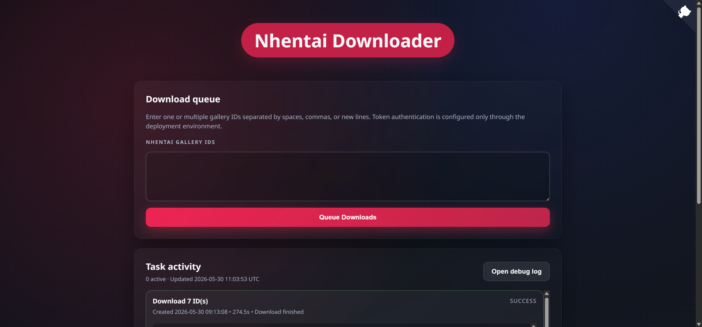

# nhentai-downloader-web

A lightweight **Flask Web UI** for [doujinshi-dl](https://github.com/RicterZ/doujinshi-dl), powered by the [doujinshi-dl-nhentai](https://pypi.org/project/doujinshi-dl-nhentai/) plugin.

Download galleries from **nhentai.net** using gallery IDs through a simple web interface, with background task processing, real-time logs, and automatic CBZ output.

> 💻 Built with **Codex (ChatGPT)**.

## 🖼️ Preview
<p align="center">
  
</p>

## ✨ Features

- 🐳 Docker and local deployment
- 🔐 Password-protected Web UI
- 📥 Download by nhentai gallery ID
- 🔑 API token configured through deployment environment variables only
- 📋 Background download queue with task status
- 📜 Real-time download logs through the debug log viewer
- 📦 Automatic CBZ output
- 🧹 Original download directories removed after CBZ creation

## 🐳 Docker Run

```bash
docker run -d \
  -p 61234:61234 \
  -e NHENTAI_PASSWORD=yourpassword \
  -e DOUJINSHI_DL_TOKEN=YOUR_API_TOKEN \
  -v /your-path:/nhentai \
  ghcr.io/ezn24/nhentai-downloader-web:latest
```

Open:

```text
http://localhost:61234
```

`DOUJINSHI_DL_TOKEN` is applied by running:

```bash
doujinshi-dl --token "YOUR_API_TOKEN"
```

before downloads begin.

The Web UI does **not** accept or expose the token.

## 🛠️ Build Docker Image

Clone or enter the project directory:

```bash
cd /path/to/nhentai-downloader-web
```

Build the image:

```bash
docker build -t nhentai-downloader-web .
```

Run it:

```bash
docker run -d \
  -p 61234:61234 \
  -e NHENTAI_PASSWORD=yourpassword \
  -e DOUJINSHI_DL_TOKEN=YOUR_API_TOKEN \
  -v /your-path:/nhentai \
  nhentai-downloader-web
```

Then open:

```text
http://localhost:61234
```

## 💻 Local Run

Create a `.env` file in the project directory:

```env
NHENTAI_PASSWORD=yourpassword
DOUJINSHI_DL_TOKEN=YOUR_API_TOKEN
DOWNLOAD_PATH=C:\path\to\download
```

Create a Python virtual environment:

```bash
python -m venv .venv
```

### Linux / macOS

```bash
source .venv/bin/activate
pip install -r requirements.txt
python nhentai.py
```

### Windows

```powershell
.\.venv\Scripts\Activate.ps1
pip install -r requirements.txt
python nhentai.py
```

Then open:

```text
http://localhost:61234
```

## ⚙️ Environment Variables

| Variable | Description | Default | Example |
| --- | --- | --- | --- |
| `NHENTAI_PASSWORD` | Password required to access the Web UI. Stored in the browser cookie for 30 days. | `admin` | `mystrongpassword` |
| `DOUJINSHI_DL_TOKEN` | API token applied through `doujinshi-dl --token` before downloads. | Empty | `YOUR_API_TOKEN` |
| `DOWNLOAD_PATH` | Directory where downloaded galleries are stored. | `/nhentai` | `/download` |
| `DEFAULT_FORMAT` | Default filename format. | `%a%t` | `%a%t-%i` |
| `DOUJINSHI_DL_URL` | Mirror / base URL used by `doujinshi-dl-nhentai`. | `https://nhentai.net` | `https://nhentai.net` |

## 🔌 API

### Queue a Single Download

```bash
curl -X POST http://localhost:61234/api/download \
  -H "Content-Type: application/json" \
  -H "X-API-Password: yourpassword" \
  -d "{\"id\":\"625927\"}"
```

### Queue Multiple Downloads

```bash
curl -X POST http://localhost:61234/api/download \
  -H "Content-Type: application/json" \
  -H "X-API-Password: yourpassword" \
  -d "{\"ids\":[\"625927\",\"625928\"]}"
```

The API also accepts `id`, `ids`, or `gallery_id` through form fields or query parameters:

```bash
curl -X POST "http://localhost:61234/api/download?ids=625927,625928" \
  -H "X-API-Password: yourpassword"
```

Successful requests return **HTTP `202`** with the queued task ID.

### Check Queue Status

```bash
curl http://localhost:61234/queue-status
```
